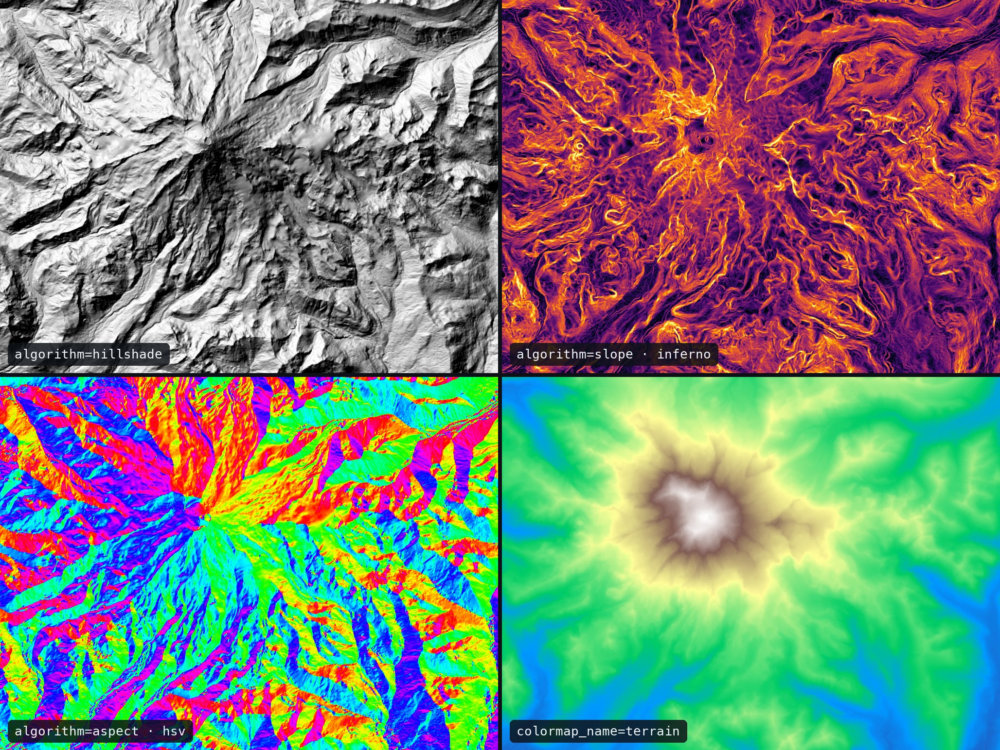
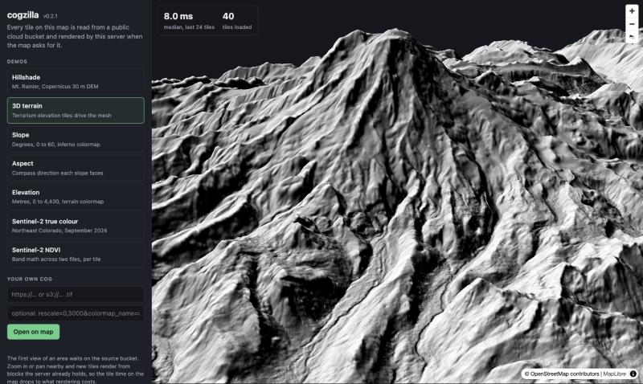

<p align="center">
  
</p>

# `cogzilla`

[](https://github.com/moradology/cogzilla/actions/workflows/ci.yml)
[](https://github.com/moradology/cogzilla/releases/latest)
[](LICENSE)

**A COG & STAC tile server that speaks TiTiler's API, without GDAL.** Written in Rust. Point your map client at a new base URL and keep everything else.

| Against TiTiler | `cogzilla` | TiTiler | |
| :--- | ---: | ---: | ---: |
| CPU per 1,000 tiles it has never seen (real S3 COGs) | **13.2 CPU-s** | 56.0 CPU-s | **4.3× less** |
| CPU per 1,000 tiles once source blocks are cached | **1.7 CPU-s** | 55.3 CPU-s | **32× less** |
| Warm tiles per second over HTTP, 4-vCPU Linux | **3,363** | 85 | **40×** |
| Warm tiles per second over HTTP, Apple M5 | **13,195** | 180 | **73×** |
| Reprojected 3-band RGB / 3-asset STAC band-math tile (M5, warm) | **1.0–1.2 ms** | 45–50 ms | **43–46×** |
| GeoJSON polygon statistics / 3-asset STAC point query (M5, warm) | **1.49 / 0.24 ms** | 112 / 18 ms | **75×** |
| Memory at idle | **4 MiB** | 1,112 MiB | **278× less** |

Plan with the 4.3×: uncached tiles are what an origin behind a CDN mostly serves. The larger multiples need the block cache to hold your working set, and the warm rows are local files with no network (lossy WebP on 4-vCPU Linux is **10.9×** warm / **7.0×** cold vs GDAL). Each row comes from a single benchmark run; hardware, method and caveats are in [docs/benchmarks.md](docs/benchmarks.md).

<p align="center">
  
</p>

Mt. Rainier from the public Copernicus 30 m DEM on S3, four ways from one file. Nothing is pre-rendered: every tile is resampled, shaded, colormapped and encoded when it is requested, at 3,372 hillshade tiles per second on an M5 once the source blocks are cached.

## Try the demo

One command, no data to download and no account:

```bash
docker run --rm -p 8080:8080 ghcr.io/moradology/cogzilla:0.5.6
```

Then open <http://localhost:8080>.

<p align="center">
  
</p>

The server's own front page is the demo. It has one-click maps of public data (Mt. Rainier as hillshade, slope, aspect and 3D terrain; Sentinel-2 true colour and NDVI), a box for your own COG URL, and a readout of how long each tile took. The first view of an area waits on S3; after that, tiles like the ones above render in a few milliseconds from cached blocks.

## Use it

Request tiles from any COG over HTTP, S3, GCS or Azure Blob:

```text
GET http://localhost:8080/cog/tiles/WebMercatorQuad/{z}/{x}/{y}.png?url=s3://your-bucket/your.tif
```

Prebuilt binaries for Linux and macOS (x86_64 and arm64) and native **AWS Lambda** `bootstrap` zips (`provided.al2023`, arm64 & x86_64 — see the [AWS Lambda deploy guide](deploy/lambda/README.md)) are on the [releases page](https://github.com/moradology/cogzilla/releases/latest). To build from source: `cargo build --release -p cogzilla-server` (or `-p cogzilla-lambda`).

## What it does

- **TiTiler's routes**: `/cog`, `/stac`, `/mosaicjson`, `/colorMaps` and `/tileMatrixSets`, with tiles, TileJSON, previews, crops, point queries and statistics.
- **Any COG**: all eight numeric types, DEFLATE, ZSTD, LZW, JPEG and WebP compression, and sources in 3,260 EPSG coordinate systems (UTM, state plane, national Lambert and Albers grids, polar grids, LAEA Europe) plus MODIS sinusoidal.
- **Rendering per request**: rescaling, all 211 `rio-tiler` colormaps, band math (`expression=` or presets such as `ndvi`), multi-file composites and mosaics.
- **Terrain**: hillshade, slope and aspect, plus Terrarium and Terrain-RGB tiles for 3D maps.
- **Cloud storage**: S3, GCS, Azure Blob and plain HTTP, configured with the same environment variables as GDAL.
- **Operations**: a single binary with no GDAL or Python to install, a block cache with an optional disk tier, `ETag` and `Cache-Control` headers, and Prometheus metrics.

## Coming from TiTiler

Change the base URL. The `/cog`, `/stac`, `/colorMaps` and `/tileMatrixSets` routes pass 39 of 39 differential checks against a live TiTiler 2.4; the mosaic routes and terrain algorithms are newer and not yet in that set. Outputs are the same picture but not the same bytes.

`cogzilla` is not a general replacement. It has no pgSTAC and no custom Python algorithms or readers, and it only reads GeoTIFFs in the [coordinate systems it can place exactly](docs/api.md#coordinate-systems). For anything else, use TiTiler. A TiTiler option that `cogzilla` does not implement returns a `400` rather than being ignored; the full list is in [docs/api.md](docs/api.md#differences-from-titiler).

**Running it on the public internet?** Set `COGZILLA_ALLOWED_URL_PREFIXES`. By default the server opens any `url=` it is given, including local paths.

## Documentation

| | |
| :--- | :--- |
| [API](docs/api.md) | Every route and parameter, example requests, and live demo links |
| [Running and configuring](docs/configuration.md) | Flags, cache sizing, cloud credentials, and operational endpoints |
| [AWS Lambda](deploy/lambda/README.md) | One-command deploy script, SAM template, and Terraform snippet |
| [Benchmarks](docs/benchmarks.md) | Where each number comes from and what it does not show |
| [How it works](docs/architecture.md) | Why there is no GDAL, the four pipeline stages, and the crates |

## License

[MIT](LICENSE)
