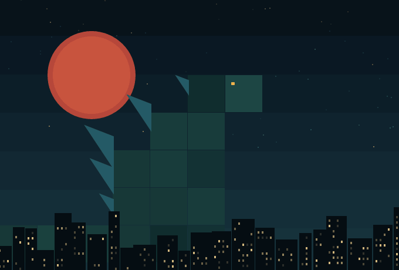

<p align="center">
  
</p>

# `cogzilla`

[](https://github.com/moradology/cogzilla/actions/workflows/ci.yml)
[](https://github.com/moradology/cogzilla/releases/latest)
[](LICENSE)

**A COG & STAC tile server that speaks TiTiler's API, without GDAL.** Written in Rust, it serves the same `/cog/*` and `/stac/*` routes for about a quarter of the CPU on tiles it has never seen, and about a thirtieth once the source blocks are in its cache. Point your map client at a new base URL and keep everything else.

Measured against real COGs on S3 (Sentinel-2, USGS 3DEP, Copernicus DEM), with TiTiler tuned per its own guidance and given one worker per core:

| Real S3 COGs, equal mix of five workloads | `cogzilla` | TiTiler | Gain |
| :--- | ---: | ---: | ---: |
| CPU per 1,000 tiles, never seen before | **13.2 CPU-s** | 56.0 CPU-s | **4.3×** |
| CPU per 1,000 tiles, source blocks cached | **1.7 CPU-s** | 55.3 CPU-s | **32×** |
| Tiles per second per busy core, cached | **588** | 18 | **32×** |
| Memory at idle | **4 MiB** | 1,112 MiB (10 workers) | **278×** |
| Instances for 1,000 uncached tiles/s (modeled, `c7g.xlarge`) | **11** | 47 | **4.3×** |

And the ceiling, with the network taken out entirely (local files, warm cache), on two machines:

| Local fixtures, warm cache | Apple M5, 10 cores | Linux x86-64, 4 vCPU |
| :--- | ---: | ---: |
| HTTP throughput, Mercator PNG, 32 concurrent | 6,863 vs 181 tiles/s: **37.8×** | 1,502 vs 72 tiles/s: **20.8×** |
| HTTP throughput, satellite RGB PNG, 32 concurrent | 3,791 vs 171 tiles/s: **22.2×** | 812 vs 82 tiles/s: **9.9×** |
| Single Mercator PNG tile | 634 µs vs 17.6 ms: **27.7×** | 1.78 ms vs 24.4 ms: **13.8×** |
| Landsat three-file RGB PNG tile | 1.63 ms vs 25.4 ms: **15.6×** | 3.39 ms vs 71.9 ms: **21.2×** |

Each cell is `cogzilla` against TiTiler on the same machine. The Linux column is a GitHub-hosted runner (AMD EPYC, shared) running the same kind of build as the release binaries.

### What these numbers do and don't say

- **The 4.3× is the number to plan with.** It is CPU for a tile the server has not seen, which is what an origin behind a CDN mostly serves. It ranged from 2.1× to 4.8× on four workloads (the fifth showed 8.3×, but its file was small enough to be partly cached) and does not depend on the network.
- **The local multiples depend on the machine.** Warm PNG tiles are 15–42× on the M5 and 14–21× on the 4-vCPU Linux runner; HTTP throughput is 22–38× and 10–21×. The Linux figures are from a hosted shared runner (`generic` release build). Quote the Linux range if you need one number for a typical cloud instance.
- **Not every path is that far ahead.** On the Linux run, lossy WebP output was 4.1× faster and first-touch (cold) local tiles were 6.5–14.1× faster (low-zoom multi-file scenes are now 23–38× faster with adaptive quadtree projection). One raw decode path remained slightly slower than GDAL on x86-64 (LZW with predictor 1 at 0.8×, `0.9×` with `target-cpu=native`; DEFLATE with predictor 2 is 1.1–1.2× and LZW with predictor 3 is 1.3–1.4×). Those are decode-only measurements, and a warm tile does no decoding.
- **The S3 results are M5-only.** The CPU, memory and cost figures in the first table have not been repeated on x86.
- **The larger multiples (13–62× on S3) need the cache to fit.** `cogzilla` keeps decoded blocks in memory and TiTiler keeps none, which is where the big multiples come from. With the default 512 MiB cache, three of the five S3 workloads outgrew it and fell back to S3. Size `--cache-mb` to your working set and budget about 250 MiB on top.
- **No uncached latency win has been measured.** The S3 run was made from a home network, where both servers were limited by bandwidth and finished roughly level. Lower CPU should become lower latency in-region, but that run has not been done.
- **The cost row is a model, not a bill.** It assumes a Graviton vCPU does half the work of an M5 core, 60% target utilization, and compute only. The ratio is measured; the instance counts are not.
- **Same picture, not the same bytes.** Valid-data masks agree with TiTiler on 99.6–100% of pixels; pixel values differ slightly on high-frequency imagery (32–34 dB PSNR on Sentinel-2, 49–54 dB on DEMs).
- **One request in 822 failed.** A single uncached tile returned HTTP 500 during the S3 run, most likely an S3 connection failure that was not retried. Retries and timeouts for that case were added in 0.1.2; the benchmark has not been re-run since.

Method, per-workload tables and caveats are in [benches/S3_BENCHMARK.md](benches/S3_BENCHMARK.md); the full local suite is in [benches/COGMARK.md](benches/COGMARK.md).

## Install

```bash
# Docker (linux/amd64 + linux/arm64)
docker run --rm -p 8080:8080 ghcr.io/moradology/cogzilla:0.1.3
```

```bash
# Prebuilt binary: Linux and macOS, x86_64 and arm64
curl -L https://github.com/moradology/cogzilla/releases/download/v0.1.3/cogzilla-server-v0.1.3-x86_64-unknown-linux-gnu.tar.gz | tar xz
```

Then open a live map of a public Sentinel-2 scene (northeast Colorado, no credentials needed):

```text
http://localhost:8080/cog/WebMercatorQuad/map.html?url=https://sentinel-cogs.s3.us-west-2.amazonaws.com/sentinel-s2-l2a-cogs/13/T/EE/2024/9/S2A_13TEE_20240929_0_L2A/TCI.tif
```

Or request tiles from any COG reachable over HTTP or S3:

```text
GET http://localhost:8080/cog/tiles/WebMercatorQuad/{z}/{x}/{y}.png?url=s3://your-bucket/your.tif
```

Other targets (`aarch64-unknown-linux-gnu`, `aarch64-apple-darwin`, `x86_64-apple-darwin`) and `SHA256SUMS` are on the [releases page](https://github.com/moradology/cogzilla/releases/latest). To build from source, see [Building and running](#building-and-running).

### Coming from TiTiler

Change the base URL. `cogzilla` implements TiTiler 2.4's non-Postgres routers (`/cog`, `/stac`, `/colorMaps`, `/tileMatrixSets`) and passes 39/39 differential HTTP checks against a live TiTiler. That is evidence for the routes and parameters [listed below](#api), not a promise of parity with every TiTiler feature, extension, or deployment: there is no `/mosaicjson`, no pgSTAC, and no custom algorithms or readers. If your workload uses something that is missing or behaves differently, please open an issue.

## Why no GDAL?

GDAL reads hundreds of formats in thousands of projections, and it is very good at that. A tile server for COGs needs a small corner of it: one container format, a handful of codecs, and the projections satellite imagery actually ships in. `cogzilla` implements only that corner, which lets each stage be specialized: a TIFF parser that opens a file in about a microsecond, closed-form projection math, and decode, resample, band math, and encode fused into a single SIMD pass.

The cost is scope. If your data is not a GeoTIFF, or is in a projection outside the supported list, use TiTiler.

## How it works

Rust, explicit SIMD (ARM64 NEON, and x86_64 AVX2/FMA chosen at runtime), and native codecs (`libdeflate`, `zstd`, `libwebp`, `zune-jpeg`). There are four stages.

**Reading.** A Classic/BigTIFF and GeoKey parser opens a local file through `mmap` in about a microsecond (0.92–1.3 µs, hundreds of times faster than `GDALOpenEx`). A remote file opens with one speculative 128 KiB range request. Later reads coalesce adjacent byte ranges, S3 requests are SigV4-signed and gated by a throttle-only AIMD concurrency limiter, and decoded blocks go into a sharded LRU cache (with an optional persistent CRC32-checked tier-2 disk cache for compressed blocks) that collapses concurrent requests for the same block into one fetch.

**Decoding.** DEFLATE, ZSTD, LZW, JPEG and WebP compression, with TIFF predictors 1, 2 and 3 written in NEON and AVX2 and bit-exact against GDAL (`float32` predictor 3 runs at 3.00 GB/s on ZSTD on the M5). Multi-block cold misses decode in parallel across worker threads. All eight GDAL numeric types from `uint8` to `float64` are supported, with `uint8` and `uint16` stored in native compact slabs (1–2 bytes/pixel for 2–4× higher cache capacity). Blocks that are entirely nodata are flagged at decode, so empty tiles return in under 200 ns.

**Projecting.** Closed-form `f64` math for `EPSG:3857`, `EPSG:4326`, all 120 WGS84/NAD83 UTM zones, CONUS and California Albers, Lambert Conformal Conic, and Polar Stereographic (`3413`, `3031`). Tiles at `z <= 8` use adaptive error-bounded quadtree subdivision (`< 0.05 px` tolerance); tiles at `z >= 9` interpolate a 17×17 grid. Zooms 0 to 22 are served.

**Rendering.** One pass per scanline does the resampling (nearest, bilinear or cubic), multi-COG compositing, early-exit dynamic mosaics (`/mosaic/tiles`), band math, rescaling and colormap lookup, then encodes PNG, JPEG, WebP or raw `float32`. Band math is either an arbitrary `expression=` compiled to a small bytecode VM or a built-in preset (`ndvi`, `ndwi`, `nbr`, `savi`, `evi`, `db`, `sar_rgb`). All 211 `rio-tiler` colormaps are included.

## Building and running

```bash
cargo build --release -p cogzilla-server

./target/release/cogzilla-server \
  --bind 127.0.0.1:8080 \
  --cache-mb 1024 \
  --dataset dem=/path/to/dem.tif \
  --scene landsat=/path/to/SR_B4.TIF,/path/to/SR_B3.TIF,/path/to/SR_B2.TIF \
  --scene sar=/path/to/OPERA_VV.tif,/path/to/OPERA_VH.tif
```

| Flag | Default | Meaning |
| :--- | :--- | :--- |
| `--bind` | `127.0.0.1:8080` | Listen address. The Docker image fixes this to `0.0.0.0:8080`; remap the port with `-p`. |
| `--cache-mb` | `512` | Decoded-block cache size in MiB (tier 1, RAM). Size it to your working set (see the cache note above). |
| `--disk-cache-dir` | | Directory for persistent compressed-block cache (tier 2, local disk/NVMe). |
| `--disk-cache-mb` | `0` | Maximum tier-2 disk cache size in MiB (`0` disables tier 2). |
| `--dataset name=path` | | Pre-register a local COG, served at `/tiles/{name}/{z}/{x}/{y}`. Repeatable. |
| `--scene name=a.tif,b.tif[,c.tif]` | | Pre-register a multi-file scene (for example Landsat RGB or SAR VV+VH). Repeatable. |

`--dataset` and `--scene` are optional: the `/cog` and `/stac` routes open any `url=` on demand.

## Configuration

S3 and HTTP behavior is set through the same environment variables GDAL and the AWS SDKs use, so an existing TiTiler deployment's settings mostly carry over.

| Variable | Purpose |
| :--- | :--- |
| `AWS_ACCESS_KEY_ID`, `AWS_SECRET_ACCESS_KEY`, `AWS_SESSION_TOKEN` | Static or temporary credentials. |
| `AWS_PROFILE`, `AWS_SHARED_CREDENTIALS_FILE` | Credentials from a shared credentials file. |
| (none) | ECS task roles and EC2 instance roles (IMDSv2) are picked up automatically. Set `AWS_EC2_METADATA_DISABLED=true` to skip the instance lookup. |
| `AWS_NO_SIGN_REQUEST=YES` | Send unsigned requests, for public buckets. |
| `AWS_REQUEST_PAYER=requester` | Access requester-pays buckets. |
| `AWS_REGION`, `AWS_DEFAULT_REGION` | Default region. A bucket in another region is discovered from S3's redirect and remembered. |
| `AWS_ENDPOINT_URL`, `AWS_S3_ENDPOINT`, `AWS_HTTPS`, `AWS_VIRTUAL_HOSTING=FALSE` | S3-compatible stores (MinIO, Ceph, and so on) and path-style addressing. |
| `GDAL_HTTP_MAX_RETRY` (or `AWS_MAX_ATTEMPTS`) | Retries for transient failures. Default 3. |
| `GDAL_HTTP_CONNECTTIMEOUT`, `GDAL_HTTP_TIMEOUT` | Connect timeout (default 10 s) and per-read timeout (default 30 s). Since 0.1.2. |
| `COGZILLA_MAX_UPSTREAM_FETCHES` | Maximum concurrent S3/HTTP range requests (default 64). Backs off automatically on `429`/`503`/timeouts (AIMD, floor 4) and recovers on clean responses. |
| `COGZILLA_MAX_OPEN_URIS` | Maximum cached opened-COG headers in memory (default 4,096, LRU-evicted). |
| `RUST_LOG` | Log level, for example `info` (the default) or `debug`. |

Operational endpoints: `GET /healthz` for liveness, `GET /stats` for cache and I/O counters as JSON, and `GET /docs` with `GET /openapi.json` for the route list.

## API

`cogzilla-server` implements the routers of TiTiler 2.4 that do not need Postgres, so MapLibre, Leaflet, OpenLayers and QGIS clients can switch by changing the base URL. The routes below are covered by 39 differential HTTP checks against a live TiTiler (`benches/titiler_diff_oracle.py`), all passing.

**`/cog/*`** (TiTiler's `TilerFactory`)

- Tiles: `GET /cog/tiles/{tileMatrixSetId}/{z}/{x}/{y}[@{scale}x][.{png|webp|jpg|f32}]`, for `WebMercatorQuad` and `WorldCRS84Quad`. `@1x` is 256 px and `@2x` is 512 px.
- Tile parameters: `rescale`, `colormap_name`, `colormap` (JSON), `expression`, `resampling`, `nodata`, `unscale`, `return_mask`, `color_formula`, `buffer`.
- Metadata: `GET /cog/info`, `/cog/info.geojson`, `/cog/bounds`, `/cog/{tms}/tilejson.json`, `/cog/tiles`, `/cog/tiles/{tms}`, `/cog/{tms}/map.html`.
- Point and statistics: `GET /cog/point/{lon},{lat}` (with `coord_crs`), `GET|POST /cog/statistics` (POST clips to a GeoJSON polygon).
- Crops: `GET /cog/preview[/{w}x{h}][.{ext}]`, `GET /cog/bbox/{minx},{miny},{maxx},{maxy}[/{w}x{h}][.{ext}]`, `POST /cog/feature[/{w}x{h}][.{ext}]`.

**`/stac/*`** (TiTiler's `MultiBaseTilerFactory` with `STACReader`)

- `GET /stac/assets`, `/stac/info`, `/stac/info.geojson`, `/stac/asset_statistics`, `/stac/tiles`, `/stac/tiles/{tms}`, `/stac/tiles/{tms}/{z}/{x}/{y}[@{scale}x][.{ext}]`, `/stac/{tms}/tilejson.json`, `/stac/{tms}/map.html`, `/stac/point/{lon},{lat}`, `/stac/preview[/{w}x{h}][.{ext}]`, `/stac/bbox/...`; `GET|POST /stac/statistics`; `POST /stac/feature[/{w}x{h}][.{ext}]`.
- The STAC item can be a local path, an HTTP(S) URL or an `s3://` URI. Its JSON is cached, and assets named with `?assets=red&assets=green&assets=blue` are opened concurrently.
- Expressions can use band positions, `(b1-b2)/(b1+b2)`, or asset names, `(red-green)/(red+green)`.
- On the M5, with local fixtures and a warm cache, these routes ran 21–82× faster than TiTiler: STAC tiles 2.1 ms against 48.6 ms, TileJSON 63.5×, info 45.3×, three-asset point queries 82.4×.

**`/colorMaps`** and **`/tileMatrixSets`**

- `GET /colorMaps`, `GET /colorMaps/{colorMapId}`: the lookup tables match `rio-tiler`'s exactly, and `?f=png` returns a 256×20 colorbar.
- `GET /tileMatrixSets`, `GET /tileMatrixSets/{tileMatrixSetId}`: `WebMercatorQuad` (25 levels) and `WorldCRS84Quad` as OGC TileMatrixSet 2.0 JSON.

**Differences worth knowing**

- `resampling` accepts `nearest`, `bilinear` and `cubic`. `lanczos` and `cubicspline` are served as cubic, and any other value falls back to bilinear without an error.
- Remote sources are `http(s)://`, `s3://` and `/vsis3/`. Other GDAL virtual filesystems such as `/vsicurl/` are not recognized.
- Shorthands that TiTiler does not have: `GET /cog/tiles/{z}/{x}/{y}` assumes `WebMercatorQuad`, `GET /mosaic/tiles/{tms}/{z}/{x}/{y}?url=a&url=b` renders a front-to-back dynamic mosaic with early exit once 100% of pixels are filled, `expr=` is an alias for `expression=` (both accept the preset names), and `/tiles/{name}/...` serves datasets registered at startup.

### Example requests

```text
# Pre-registered Landsat C2 three-file uint16 RGB
GET /tiles/landsat/12/652/1583.png?rescale=7500,22500

# Pre-registered OPERA RTC-S1 dual-pol SAR false color ([VV_dB, VH_dB, VV_dB - VH_dB])
GET /tiles/sar/12/652/1583.png?expr=sar_rgb

# Landsat NDVI composited from two S3 COGs, as WebP
GET /cog/tiles/WebMercatorQuad/12/652/1583.webp?url=s3://bucket/B5.tif&url=s3://bucket/B4.tif&expr=ndvi&rescale=-0.2,0.8&colormap_name=rdylgn&quality=82

# Single-pol SAR linear power to dB, as raw float32 for WebGL or deck.gl
GET /cog/tiles/WebMercatorQuad/12/652/1583.f32?url=s3://bucket/VV.tif&expr=db
```

## Benchmarks

- [benches/S3_BENCHMARK.md](benches/S3_BENCHMARK.md): real COGs on S3 against a tuned TiTiler, covering time, memory and cost, with caveats and reproduction steps. This is the source of the first table above.
- [benches/COGMARK.md](benches/COGMARK.md): the local `BM-01` to `BM-11` suite against GDAL, `rio-tiler` and TiTiler on synthetic fixtures, on an Apple M5 and on a Linux x86-64 runner, with reproduction steps. This is the source of the second table, and it is the best case: no network and a warm cache. The Linux numbers come from the manually triggered [COGMark workflow](.github/workflows/bench.yml).

## Workspace crates

- `crates/cogzilla-tiff`: Classic/BigTIFF and GeoKey parser with a compact IFD index, for all eight numeric types, tiled or stripped.
- `crates/cogzilla-codec`: DEFLATE, ZSTD, LZW, JPEG and WebP block decoding, NEON/AVX2 predictors 1/2/3, and per-block nodata statistics.
- `crates/cogzilla-proj`: closed-form projections (`EPSG:3857`, `4326`, UTM, Albers, LCC, Polar Stereographic) and the per-tile reprojection planners.
- `crates/cogzilla-kernel`: fused SIMD resampling (nearest, bilinear, cubic), rescaling, band math, colormaps, and the PNG, JPEG, WebP and raw `float32` encoders.
- `crates/cogzilla-io`: `mmap` and ranged HTTP/S3 backends (SigV4, retries, timeouts) and the singleflight block cache.
- `crates/cogzilla-server`: the `hyper` HTTP/1.1 and HTTP/2 server and CLI.
- `benches/cogmark`: the `BM-01` to `BM-11` suite and GDAL parity oracle.
